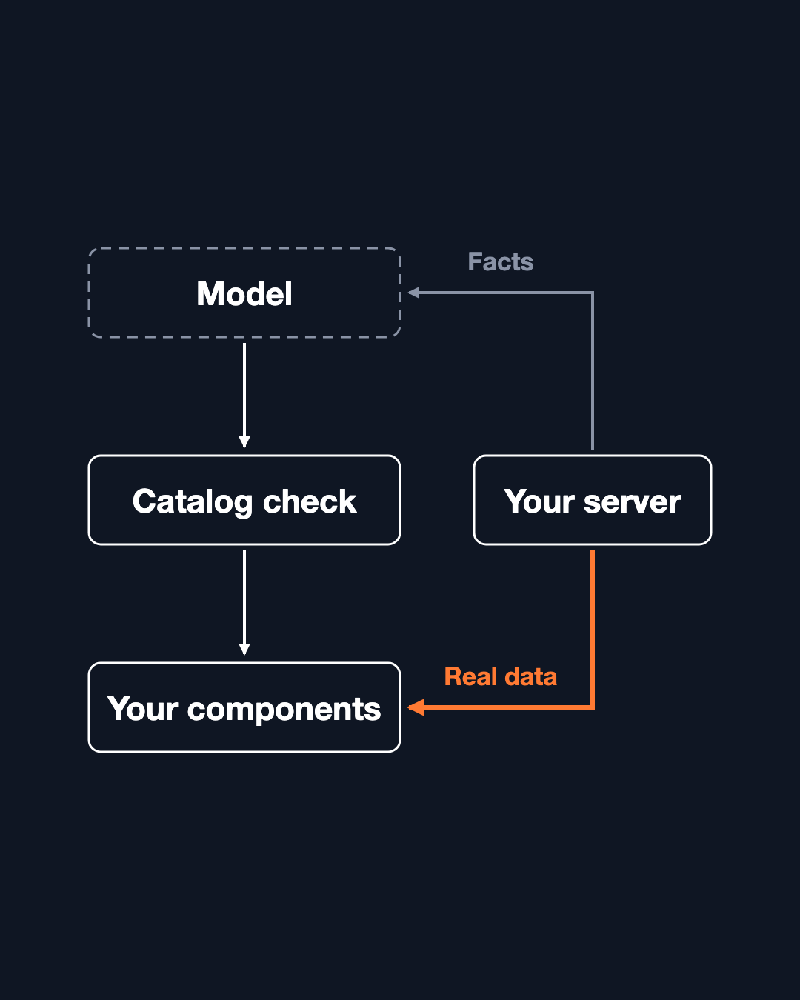

# Expense Copilot: an A2UI 1.0 demo

An AI agent that answers with **your app's own interface** instead of a paragraph.

An employee scans a receipt. The agent replies with a receipt card, policy checks, a live budget
meter and a business-purpose field. On submit it sends an approval card to the manager's phone, and
when the manager approves, the employee's card updates live.

Built on [A2UI](https://github.com/a2ui-project), the open protocol for agent-driven UI, using the
official SDKs: `a2ui-agent-sdk` (Python) and `@a2ui/react` / `@a2ui/web_core`.



## How it works

1. **The catalog is the guardrail.** [`catalog/build_catalog.py`](catalog/build_catalog.py) lists
   the only components the agent may use (the A2UI basics plus `ReceiptCard`, `PolicyCheck`,
   `BudgetMeter` and `ApprovalCard`), with typed props and allowed values.
2. **The model writes a layout, not code.** It arranges catalog components in A2UI Express, a short
   layout language.
3. **The SDK checks every component** against the catalog as the layout streams in. Anything
   unknown or malformed is refused before it renders.
4. **Your components render it.** The React app maps each catalog name to a real component, so the
   result always looks like the product.
5. **The server fills in private values.** The model writes a placeholder such as
   `paidWith=$/employee/card`; the server sends the real value straight to the screen in an
   `updateDataModel` message.
6. **Button presses go back to the server**, which checks state before acting.

### What the model sees, and what it never sees

| Sent to the model | Never sent to the model |
|---|---|
| Catalog: component names, props, allowed values | Component code, styles, design tokens |
| The facts the server chooses to share this turn | Private values: card number, employee ID, cost center |
| Placeholder paths such as `/employee/card` | Your APIs, database, other users |
| What the user types and which button they pressed | The rendered screen |

Open the **What the model saw** tab in the app to check this for any turn.

## Run it

Needs Python 3.11+ (installed via [`uv`](https://docs.astral.sh/uv/)) and Node 20+.

```bash
./start.sh                       # scripted agent, no API key needed
GEMINI_API_KEY=... ./start.sh    # live Gemini (set the key in your own terminal)
```

Then open http://127.0.0.1:8090. The first run installs dependencies and builds the web app.

**Scripted mode** feeds pre-written A2UI Express through the same SDK parser and catalog check, so it
renders exactly like a live run. It's the reliable choice for demos. **Live mode** uses
`gemini-3.8-flash` by default; set `GEMINI_MODEL` to use another model.

## Demo script (about 2 minutes)

1. **Pick "Nopa".** The receipt card, a policy warning and the budget bar stream in. *"These are
   our components; the agent can only use what's in our catalog."*
2. **Point at "Paid with Corporate Visa •• 4417 · server-filled".** Open **What the model saw**: the
   card number isn't in the model's input.
3. **Type a business purpose.** The required check clears as you type, with no round trip.
4. **Submit.** An approval card appears on the manager's phone: same protocol, different surface.
5. **Approve on the phone.** The status pill and the budget bar update live from one host
   `updateDataModel` message.
6. **Open Wire**: what the model wrote (Express) next to what the client received (A2UI v1.0 JSON).
7. Optional: **Hotel Zephyr** shows two exceptions and an over-budget bar; **Lyft** meets policy and
   is auto-filed.

## Where things are

| Piece | File |
|---|---|
| Catalog (the guardrail) | `catalog/build_catalog.py` → `catalog/catalog.json` |
| Company data, policy rules, private values | `server/host.py` |
| Prompt, model stream, SDK parsing, server-side data fill | `server/agent.py` |
| HTTP + server-sent events | `server/app.py` |
| React views for the 4 expense components | `web/src/components.tsx` |
| App shell (chat, phone, inspector) | `web/src/App.tsx` |

To add a component: add it to `EXPENSE_COMPONENTS` in `catalog/build_catalog.py`, write its view in
`web/src/components.tsx`, then rerun `./start.sh`.

All people, companies, receipts and card numbers in the demo are fictional.

## License

Apache 2.0, see [LICENSE](LICENSE). Catalog-building helpers are adapted from the Travel A2UI sample
in [a2ui-project/labs](https://github.com/a2ui-project/labs) (Apache 2.0).
